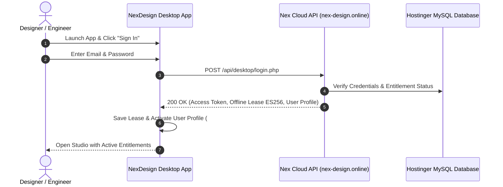

# 🚀 NexDesign Studio (v0.11.8) — Desktop Installation & User Guide

**Copyright © 2026 NexDesign Technologies. All Rights Reserved.**  
🌐 **Official Website:** [https://nex-design.online](https://nex-design.online)  
🛡️ **Admin Portal:** [https://nex-design.online/admin](https://nex-design.online/admin)

---

## 1. 📜 Copyright & Proprietary Notice

NexDesign Studio, its vector engine, CanvasKit/Skia WebAssembly rendering pipeline, Tauri desktop runtime integrations, and user interfaces are proprietary software of **NexDesign Technologies**.

Unauthorized copying, reverse engineering, decompilation, redistribution, or modification of these binaries without prior written authorization is strictly prohibited.

All trademarks, service marks, trade names, and logos are the intellectual property of NexDesign Technologies.

---

## 2. 💻 System Requirements

| Specification | Minimum Requirement | Recommended |
| :--- | :--- | :--- |
| **Operating System** | Windows 10 (64-bit) | Windows 11 (64-bit) |
| **Processor** | 64-bit Intel / AMD CPU | Intel Core i5 / AMD Ryzen 5 or better |
| **Memory (RAM)** | 4 GB | 8 GB or higher |
| **Disk Space** | 200 MB free space | 1 GB SSD space |
| **Runtime** | Microsoft Edge WebView2 (Pre-installed on Win 10/11) | Latest WebView2 Evergreen |
| **Graphics** | DirectX 11 / OpenGL compatible GPU | Dedicated GPU for 120 FPS high-refresh canvas |

---

## 3. 📦 Installation Options (Windows x64)

### Option A: Portable Standalone Executable (No Setup Required)
1. Open the release folder containing [`NexDesign.exe`](file:///f:/Coded%20projects/nex-design-v2/desktop/target/release/NexDesign.exe).
2. Double-click **`NexDesign.exe`** to launch the editor immediately.
3. You can pin `NexDesign.exe` directly to your Windows Taskbar or Desktop.

### Option B: Windows Setup Installer (Recommended)
1. Double-click **`NexDesign_0.11.8_x64-setup.exe`**.
2. Follow the on-screen Setup Wizard prompts.
3. Choose your installation path (default: `C:\Program Files\NexDesign`).
4. Launch NexDesign from your Windows Start Menu or Desktop shortcut.

### Option C: Enterprise MSI Package
1. Run **`NexDesign_0.11.8_x64_en-US.msi`**.
2. Ideal for enterprise deployments, silent network rollouts, and IT administrators.

---

## 4. 🔑 Sign In & Account Activation Guide

### Step-by-Step Login Instructions:
1. **Launch the Application:**
   Open `NexDesign.exe`.
2. **Open the User Authentication Menu:**
   Click the **Profile Pill** in the bottom-left corner of the sidebar, or click the **Settings Gear (⚙️)** on the far-left dock.
3. **Enter Credentials:**
   * **Email:** Your registered account email (e.g. `ibrahim.talat18@gmail.com`).
   * **Password:** Your account password (e.g. `Tal1985#`).
4. **Instant Verification & Offline Lease:**
   * The app contacts `https://nex-design.online/api/desktop/login.php`.
   * It validates your package (`Starter`, `Professional`, or `Teams Studio`).
   * An **ES256 ECDSA P-256** offline lease is issued to your machine, allowing you to design seamlessly **both online and offline**.
   * Your verified queue rank (e.g. `#14`) and package badge (`STARTER`) will appear on your profile pill.

---

## 5. ⚙️ User Settings & Account Management

* **User & Profile Settings (3 Tabs):**
  Click the **Settings Gear (⚙️)** on the dock or from the profile menu:
  * **Tab 1 (Identity):** Full Name, Account Email, Avatar URL, Unique Hardware Device ID.
  * **Tab 2 (Academic & Career):** University / Institution, Faculty / Major, Graduation Year, Student ID Number, Portfolio Link.
  * **Tab 3 (Environment & OS):** Preferred Operating System, Primary Design Use Cases, Offline Lease Expiry Date.
* **Adding / Switching Accounts:**
  Click the bottom profile pill $\rightarrow$ **`Add Another Account`**.
* **Signing Out:**
  Click the bottom profile pill $\rightarrow$ Click the crimson **`🚪 Sign Out`** button at the bottom of the list.

---

## 6. 🛡️ Administrator Access (Admins Only)

Administrators can review user queues, approve beta access, generate Rust cryptographic license keys, and manage package durations:
* **Web Admin Portal:** [https://nex-design.online/admin](https://nex-design.online/admin)
* **Desktop Admin Route:** [http://localhost:1420/admin](http://localhost:1420/admin)
* **Default Admin Email:** `admin@nex-design.online`
* **Default Admin Password:** `NexAdmin2026!`

---

## 7. 📬 Support & Community

* **Main Showcase:** [https://nex-design.online](https://nex-design.online)
* **Early Access Sign-Up:** [https://nex-design.online/early-access](https://nex-design.online/early-access)
* **Support Email:** `support@nex-design.online`
